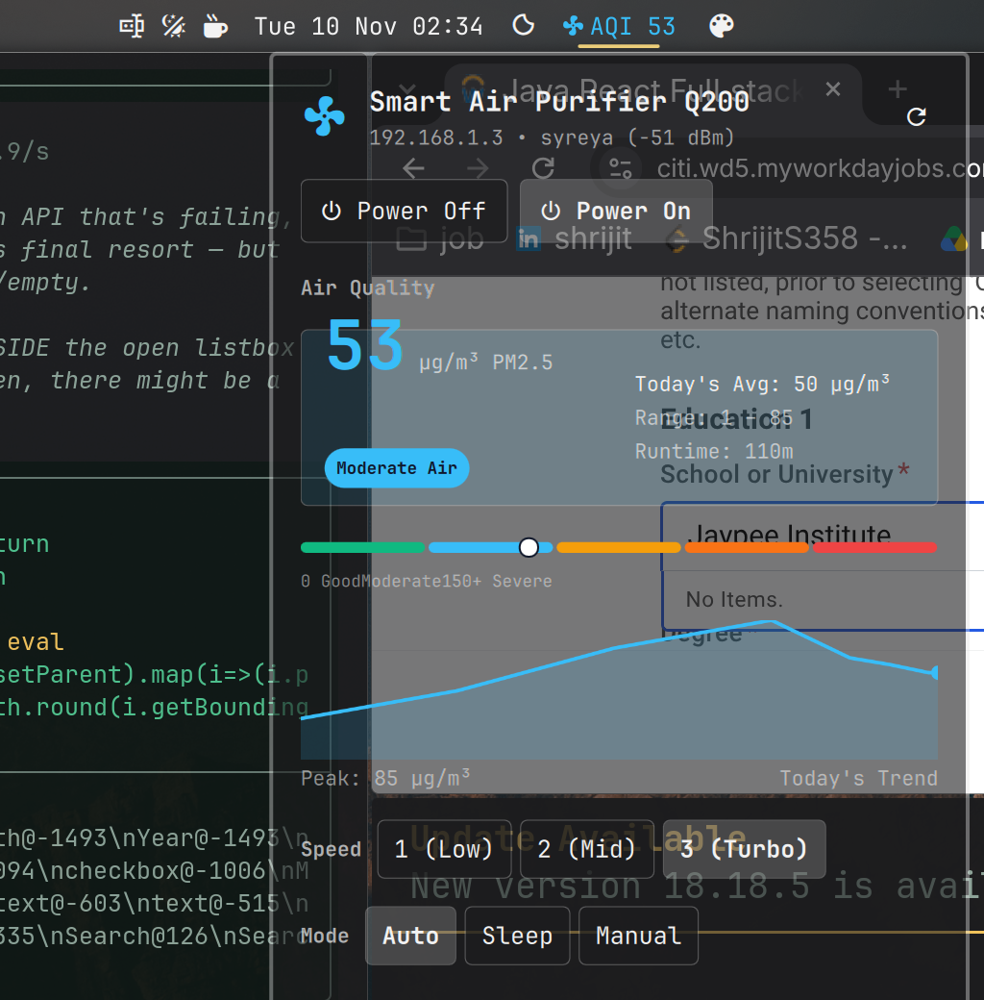

# omarchy-qubo

Native **Omarchy** shell plugin and desktop controller for **Qubo Smart Air Purifiers** (Hero Electronix HPH series, including Q200, Q500, Q1000).

Provides real-time AQI (PM2.5) telemetry on your top status bar and a drop-down control panel with live graphical trends, fan speed, operating modes, display illumination, and hardware locks.

<p align="center">
  
</p>

---

## Features

- **Status Bar Metric**:
  - Live **`󰈐 AQI <val>`** pill on the Omarchy bar with dynamic WHO color tiers (Emerald, Sky Blue, Amber, Orange, Red).
  - Hover tooltip with full device state (PM2.5, Fan Speed, Mode, Filter Life %).
  - Scroll wheel over the icon adjusts fan speed directly.
  - Middle-click toggles appliance power on/off instantly.

- **Dropdown Control Panel**:
  - **Animated Fan**: Rotating fan icon synchronized to motor speed (Turbo, Medium, Low).
  - **Power Chips**: Clean `ButtonGroup` chips for instant toggling.
  - **Air Quality Spectrum Gauge**: Multi-tier WHO scale with a live pointer tracking PM2.5.
  - **Historical AQI Canvas Chart**: Area-filled sparkline showing PM2.5 trends and peak value.
  - **Fan Speed Selector**: `1 (Low)`, `2 (Mid)`, `3 (Turbo)`.
  - **Operating Modes**: `Auto` (AI sensor regulation), `Sleep` (silent + display dim), `Manual`.
  - **Hardware Toggles**: Physical Child Lock and LED Display Light.
  - **Filter Health**: Visual health bar with percentage and hours countdown.

- **Direct MQTT Protocol**:
  - Dispatches commands over TLS MQTT (`mqtt.platform.quboworld.com:8883`) for real-time sub-second hardware response.

---

## Installation

```bash
git clone https://github.com/shrijit37/omarchy-qubo.git
cd omarchy-qubo
./install.sh
```

---

## Authentication

Authenticate once using your Qubo credentials (saved locally to `~/.qubopy_session.json`):

### Option A: Email & Password
```bash
qubopy login --email your_email@example.com
```

### Option B: Phone & SMS OTP
```bash
# 1. Request OTP
qubopy login-phone --phone 9876543210

# 2. Verify OTP
qubopy verify-otp --otp 123456
```

---

## CLI Usage

A standalone CLI is included at `~/.local/bin/qubo-control`:

```bash
# Get live device telemetry JSON
qubo-control status

# Power
qubo-control toggle
qubo-control on
qubo-control off

# Fan speed (1-3)
qubo-control speed 2

# Mode (auto, sleep, manual)
qubo-control mode auto

# Display light and child lock
qubo-control light off
qubo-control childlock enable
```

---

## Architecture

```
[ Omarchy Top Bar / Panel ]
            │ (Subprocess CLI)
            ▼
[ qubo-control ]
            │ (Paho MQTT over TLS / Port 8883)
            ▼
[ Qubo Cloud Broker (AWS Mumbai) ]
            │
            │ (Outbound persistent TLS connection)
            ▼
[ Qubo Q200 Purifier (LAN IP 192.168.1.3) ]
```

---

## License

MIT
